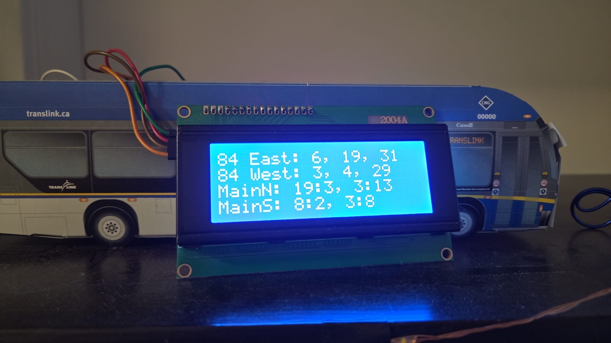
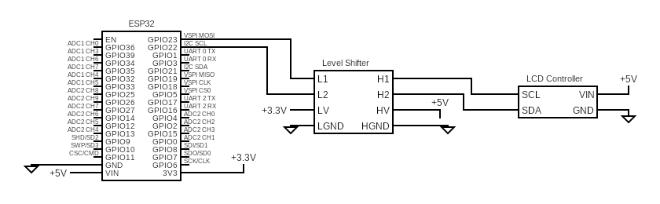

# TransLink Bus Arrival Display

## Project Overview



This project was created to answer a simple question at a glance: do I need to run for my bus? It recreates the next-bus displays commonly found at stops using an ESP32 and a 20x4 character LCD. The display can be built into a small enclosure, a 3D-printed bus model, or a framed bus print.

This project was designed for the Metro Vancouver, Canada transit system.

## Features

- Fetches realtime schedule data from the TransLink API over Wi-Fi.
- Displays up to four configured stops, one per LCD row.
- Supports up to four route numbers per stop and merges departures chronologically.
- Can be powered from USB or a suitable regulated external supply.

## Requirements

### Hardware

- ESP-WROOM-32 development board
- 20x4 LCD 2004 display with an I2C backpack
- Bidirectional 3.3 V-to-5 V I2C-compatible level shifter
- USB cable or regulated external 5 V supply
- Optional holder for three AA batteries, with exposed leads
- Jumper wires and connectors as needed

The optional three-AA holder is not itself a regulated 5 V supply. Use an appropriate regulator or converter if powering the 5 V rail from batteries. Do not connect USB and an external supply simultaneously unless the development board supports that power arrangement.

### Software

- Visual Studio Code
- PlatformIO IDE extension for Visual Studio Code
- The project uses PlatformIO's `espressif32` platform with the ESP-IDF framework.

The firmware initializes NVS and the LCD, connects the ESP32 to Wi-Fi, and starts the schedule updater only after Wi-Fi connects. The updater requests each configured stop/route pair from TransLink over HTTPS, parses each response with cJSON, and merges departure timestamps in chronological order. It retains only the compact departure data needed by the display and releases each parsed JSON document. The display task updates the corresponding LCD row for each stop. Route names and numbers are set in `src/route_config.h`; Wi-Fi credentials are provided locally in `src/secrets.h`.

## Hardware Wiring

Connect the ESP32's 3.3 V pin to the 3.3 V rail and VIN to the 5 V rail. The level shifter's LV and HV pins connect to those respective rails. Connect all grounds to the common ground rail. The LCD I2C signals must pass through the level shifter.



Use USB or the optional external supply as the power source. If using the three-AA holder, add a suitable regulator or converter for the 5 V rail. Do not connect USB and external power at the same time unless the development board supports that arrangement.

The LCD I2C address is configured as `0x27` in `src/display.c`. If your backpack uses a different address, update that setting.

## Route Configuration

Stops and their route lists are configured in `src/route_config.h`. Each entry specifies a stop number, display name, and one or more route numbers. The current configuration is:

| Stop number | Display name | Routes |
| --- | --- | --- |
| 59760 | 84 East | 84 |
| 59761 | 84 West | 84 |
| 50179 | MainN | 3, 8, 19 |
| 59580 | MainS | 3, 8, 19 |

The LCD has four rows, so configure no more than four stops. The route-number limit per stop is defined by `MAX_ROUTE_NUMBERS_PER_CONFIG` in `src/route_config.h`.

## Wi-Fi Configuration

Create `src/secrets.h` with the Wi-Fi credentials used by `src/fetch_http.c`:

```c
#ifndef SECRETS_H
#define SECRETS_H

#define WIFI_SSID "your-wifi-network"
#define WIFI_PASS "your-wifi-password"

#endif
```

`src/secrets.h` is ignored by Git. Keep credentials private and do not commit them.

## Build, Upload, and Monitor

1. Open this project folder in Visual Studio Code with the PlatformIO IDE extension installed.
2. Select the `esp32dev` environment.
3. Build the project with PlatformIO's **Build** command, or run:

   ```sh
   pio run --environment esp32dev
   ```

4. Connect the ESP32 and upload with PlatformIO's **Upload** command, or run:

   ```sh
   pio run --target upload --environment esp32dev
   ```

5. Open the serial monitor at 115200 baud using PlatformIO's **Monitor** command, or run:

   ```sh
   pio device monitor --baud 115200
   ```
